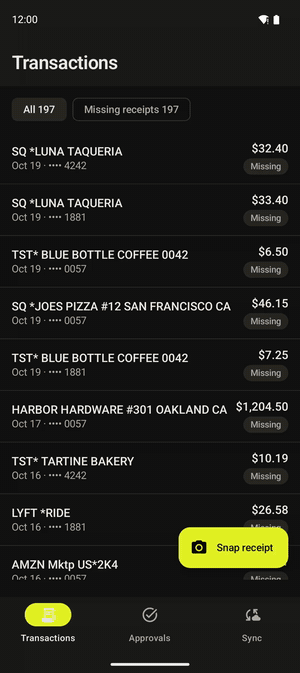
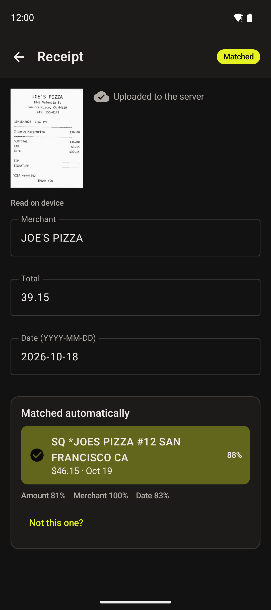
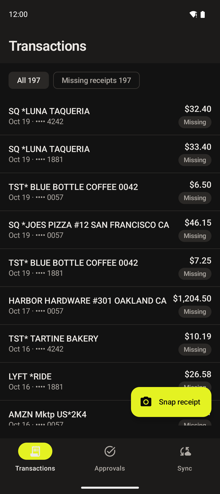

# Receipt Snap

Snap a receipt on an Android phone, read it on the device, match it to the card charge with no network, and sync it later without ever losing or duplicating it. A portfolio project built by Sanskar Pal while applying for Ramp's Android engineering role. Not affiliated with or endorsed by Ramp; all data is fictional.

**Download:** [APK on the v0.1.0 release](https://github.com/sanskarpal/ramp-receipt-snap/releases/tag/v0.1.0) · **Stack:** Kotlin · Jetpack Compose (Material 3) · MVVM + StateFlow · Hilt · Room · WorkManager · CameraX · ML Kit Text Recognition v2 (on-device, bundled) · Retrofit/OkHttp + kotlinx.serialization · Flask mock API

<p>
  
  
  
</p>

*Demo (emulator, real-time): airplane mode on → snap → read and matched on the phone → approve two requests offline (a coworker already approved one on the server) → reconnect → everything syncs; the conflicting approval rolls back with "Already approved by Priya (Finance)".*

## Why

Expense apps live or die on receipt capture in bad signal: restaurants, subways, airports. The capture flow should finish on the phone (read the receipt, find the charge, tell the user it's handled) and treat the network as an implementation detail that can fail at any point without losing anything. Ramp's [Android posting](https://jobs.ashbyhq.com/ramp/f564dcf9-9390-4a3f-896f-8047a5086040) lists Kotlin, Compose, MVVM, coroutines, Flow, Gradle and OpenAPI; this project uses all of them.

## What it does

- **Capture**: CameraX with an edge guide, the system photo picker, or bundled synthetic sample receipts (for emulators, where the camera sees a virtual room).
- **Read on device**: ML Kit Text Recognition (bundled model, so it works offline on first launch) → a pure-Kotlin parser that finds merchant, total and date with a confidence per field; low-confidence fields are highlighted for review.
- **Match offline**: scores unmatched card charges already synced to Room (amount 0.5, merchant 0.35, date 0.15). Handles tips added after signing, processor prefixes (`SQ *`, `TST*`), store numbers, and charges that post days later. AUTO only with a clear margin over the runner-up; otherwise the user picks from the top three.
- **Never lose a receipt**: image fsynced before its row exists, row before ML Kit runs, outbox row before any network call, image deleted only after a stored 2xx, and a startup sweep resumes anything a crash interrupted.
- **Sync safely**: an outbox drained by WorkManager; every operation keeps its id as the `Idempotency-Key`, so a request whose response was lost is resent and the server replays its answer.
- **Offline approvals**: approve or deny instantly; a 409 from the server ("already decided") rolls the local decision back and says by whom.
- **Sync screen**: the outbox itself, with state, attempts, last error, and an online indicator.

## Architecture

```
 CameraX / picker ──► ImageStore (fsync, then rename) ──► Room: Receipt CAPTURED
                                                              │
                              ML Kit TextRecognizer (on device, bundled model)
                                                              │
                         ReceiptParser (pure Kotlin) → extraction + confidences
                                                              │
                  MatchingEngine (pure Kotlin) ◄── Room: transactions synced earlier
                                                              │
                     Room: Match AUTO / SUGGESTED / NONE ──► Compose UI (Flow)
                                                              │
                          Outbox op (UPLOAD_RECEIPT, key = receipt UUID)
                                                              │
     WorkManager SyncWorker (network constraint) ─► SyncEngine ─► Retrofit ─► Flask mock
```

| Module | What's in it | Android? |
|---|---|---|
| `:core:model` | Domain types (money as `Long` cents) | No |
| `:core:extraction` | `ReceiptParser` | No (JVM-tested) |
| `:core:matching` | `MatchingEngine`, `MerchantNormalizer`, `Similarity` | No (JVM-tested) |
| `:core:data` | Room DB + DAOs, Retrofit API, `SyncEngine`, `RoomSyncStore`, `SyncWorker`, repositories, Hilt module | Yes |
| `:app` | Compose screens + ViewModels, navigation, theme, ML Kit wrapper, CameraX | Yes |
| `backend/` | `openapi.yaml` (the contract), Flask app with idempotency and chaos middleware, seed + sample-receipt renderer | Python |

Deliberate simplifications versus a production layout: database, network and data live in one `:core:data` module, and feature screens are packages in `:app` rather than separate modules. The Retrofit interface is hand-written to match `backend/openapi.yaml` exactly (five endpoints) instead of generated.

## Results (measured, nothing estimated)

| Claim | Result | How |
|---|---|---|
| No receipt lost or duplicated under failure (sync logic) | **0 lost, 0 duplicated** across 20 seeds × 200 receipts | `SyncEngineTest` chaos test: 30% responses dropped after the server commits, 20% 500s, 10% timeouts, an offline stretch, and the process killed at random points mid-sync |
| Same, end to end on an emulator | **20 of 20 receipts on the server, 0 duplicates, 0 full-size images left on the device; queue drained in 77 s** | `scripts/chaos_e2e.sh` on a Pixel 9 emulator (see below) |
| Images deleted only after the server has them | 0 early deletes in every chaos run | asserted in the chaos test |
| Parser + matcher on the 5 bundled sample receipts, on device | **Merchant, total and date correct on 5/5.** Matching: 2 auto-matched correctly (one with a tip added), 1 correctly found no charge, 2 sent to the picker because a same-merchant charge sat within tip range | synthetic receipts rendered by `backend/render_receipts.py`; clean images, **not** an accuracy benchmark |
| Unit tests | 29 passing | `./gradlew test` (parser 9, matcher 9, sync engine + HTTP mapping 11) |

The end-to-end chaos script queues 20 receipts while the server is down, brings it back with 30% of responses dropped after commit and 20% random 500s, force-stops the app mid-sync, takes the server down again, then waits for the queue to drain and checks the server count and the files left on the device.

**What the chaos test caught.** Before the fix, the same scenario had only 16 of 20 receipts on the server after about five minutes: each sync run stopped at the first failure and WorkManager doubled its backoff every run, even when runs were making progress. `SyncEngine.drainWithRetries()` now retries a few times in-process with jittered 1–8 s pauses and resets the streak whenever it makes progress; WorkManager's exponential backoff only takes over after four consecutive attempts with no progress. After the fix: 20 of 20 in 77 s.

### Not measured yet

Kept honest on purpose; these are next:

- Extraction accuracy on a real dataset (SROIE held-out split via an instrumented test → `eval/score.py`).
- Matching precision/recall on synthetic charges paired with real receipts.
- Shutter → matched latency (p50/p95) on a real mid-range phone; cold start before/after a Baseline Profile (Macrobenchmark).

## Where it fails

- Faded thermal paper and crumpled receipts degrade text recognition; the review screen falls back to manual edits.
- Receipts where the total's amount sits far from its label (multi-column layouts) fall back to "largest amount in the bottom 40%" with low confidence.
- Two charges from the same merchant within the tip range go to the picker. On the Luna Taqueria sample the picker's pre-selected top candidate is actually the decoy (89% vs 88%), which is exactly why it isn't auto-matched. On Blue Bottle the exact-amount charge beats a +11% decoy by only 0.08, just under the 0.10 auto-match margin. Whether an exact amount should win more decisively is a tuning question for a real evaluation set, not something to hand-tune on five samples.
- Snapping the same receipt twice creates two receipts (perceptual-hash dedupe is on the list).

## Run it

```bash
# mock API (emulator reaches it at 10.0.2.2:8000)
python3 backend/seed.py
python3 backend/render_receipts.py   # refreshes sample receipt dates
python3 backend/app.py

# app (needs JDK 17–23; Android Studio works too)
./gradlew :app:installDebug
./gradlew test

# chaos knobs while it runs
curl -X POST localhost:8000/admin/chaos -H 'content-type: application/json' -d '{"drop_rate":0.3,"failure_rate":0.2}'
bash scripts/chaos_e2e.sh            # end-to-end run on a connected emulator
```

A debug-signed APK is attached to the [v0.1.0 release](https://github.com/sanskarpal/ramp-receipt-snap/releases/tag/v0.1.0). Ramp uses Buildkite for CI; this repo uses GitHub Actions for the same build, test and lint steps.

## What I'd do next at Ramp's scale

- Move upload bytes to a resumable, chunked endpoint and let WorkManager run expedited work for the first attempt after capture.
- Generate the client from the OpenAPI spec once the surface grows, and contract-test the mock against it.
- Ship the matcher's thresholds from the server so they can be tuned per merchant category without an app release.
- Run the accuracy and latency evaluations above, and add Macrobenchmark + a Baseline Profile to CI.

---

Not affiliated with or endorsed by Ramp. Merchants, people and transactions are fictional.
